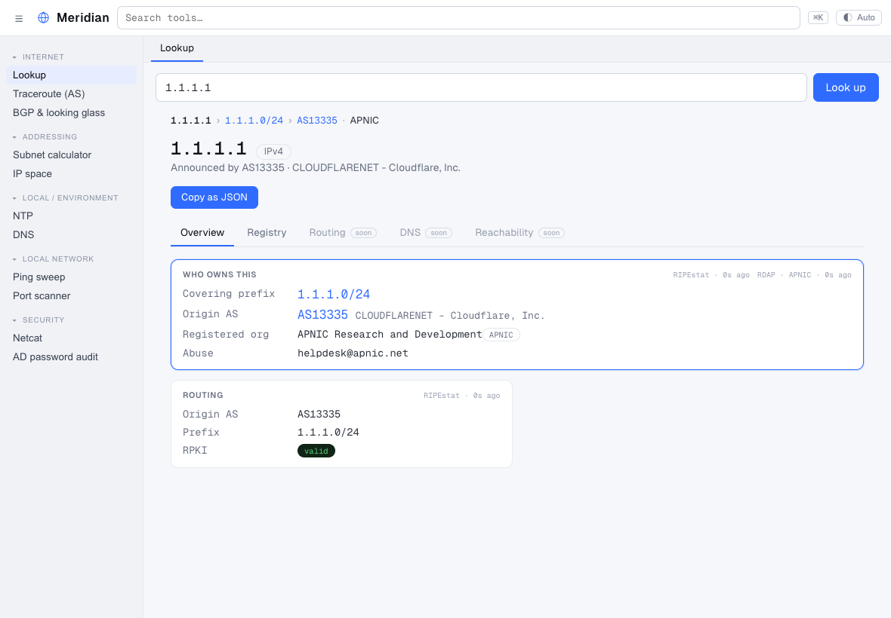
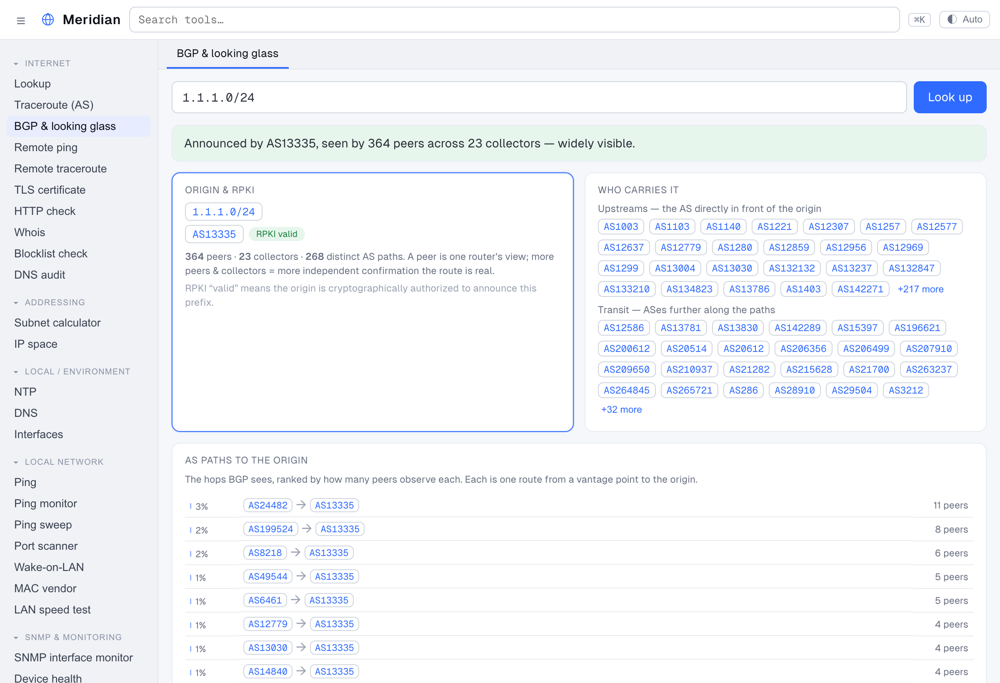
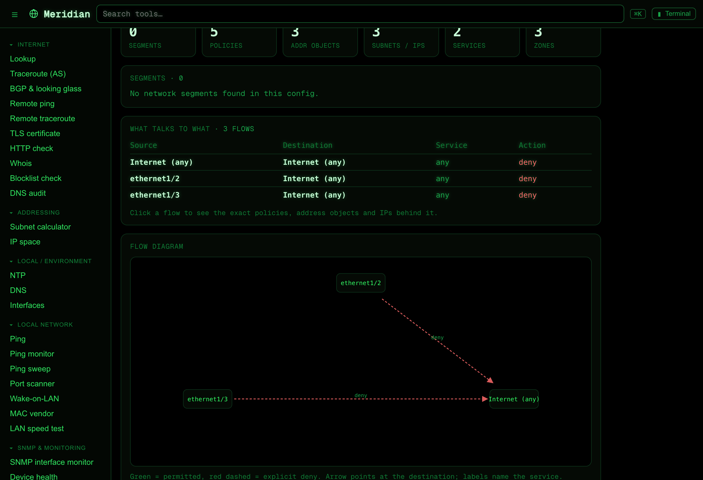
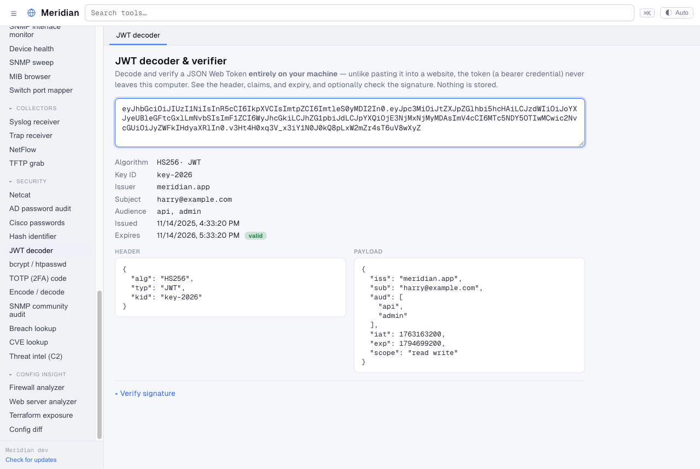
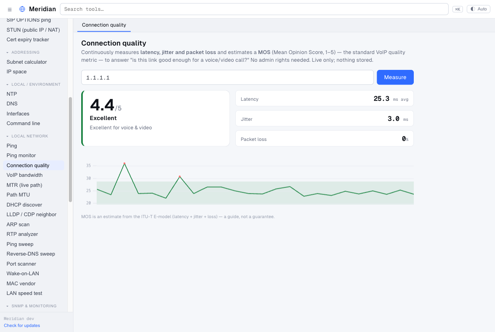

<div align="center">

# Meridian

**A cross-platform desktop toolkit for understanding networks, addresses, and routes.**

One native app for Windows, macOS, and Linux — no bundled browser, no account, no telemetry.

</div>

---

Meridian answers the everyday questions a network engineer actually asks — *who
owns this IP? what routes this prefix? is my clock source sane? what does DNS
really say?* — and explains every answer in plain language, not just raw numbers.

## Features

Every tool is point-in-time — go in, get actionable data, move on; nothing is
retained. Where a tool would normally mean pasting a secret or a token into a
website, Meridian does it locally so the data never leaves your machine.

**Internet**
- **Lookup** — paste anything (`1.1.1.1`, `AS13335`, `104.16.0.0/13`,
  `cloudflare.com`) → an entity page for the IP, ASN, prefix, or domain, with
  routing (RIPEstat), registration (RDAP), AS ownership (Team Cymru) and RPKI.
- **Traceroute (AS)** — ICMP or **TCP-SYN** (punches through firewalls that drop
  UDP/ICMP traceroute; no admin rights on macOS). Each hop is annotated with its
  AS, and each network in the path with its **PeeringDB** peering policy and
  internet-exchange presence — the path reads as "whose networks did I cross,
  and how open/connected are they".
- **BGP & looking glass** — origin AS(es) with MOAS warnings, AS paths across
  public collectors, upstreams/transit, **RPKI + IRR route-object** validation
  (the crypto and registry sides of route authorization), and vantage points.
- **TLS certificate** / **Cert & CSR decoder** — inspect a live server's cert, or
  decode a pasted PEM certificate/CSR locally.
- **Cipher scan** — TLS versions + cipher suites, graded SSL-Labs-style, with
  **post-quantum** key-exchange readiness. **SSH audit** — a server's key-exchange,
  host-key and MAC algorithms, its host-key fingerprints, and whether its key
  exchange is post-quantum. **Cert expiry** — bulk days-to-expiry. **Let's
  Encrypt** — one-shot DNS-01 issuance for firewalled sites.
- **HTTP check**, **HTTP/3 (QUIC) reachability** (handshake + Alt-Svc — tells
  "no h3 support" from "h3 blocked on your path"), **Security headers**
  (OWASP-mapped), **Service status** (Statuspage outage check), **WHOIS**,
  **Subdomains** (Certificate Transparency).
- **DNS blocklist** (DNSBL), **DNS audit** (SPF/DMARC/DNSSEC), **DNS propagation**
  (one record across a dozen global resolvers), **Email auth** (SPF/DKIM/DMARC).
- **SMTP probe** (banner / STARTTLS / cert), **SIP OPTIONS ping** (is VoIP
  signaling up?), and **STUN** (your public IP + NAT type, symmetric-NAT warning).
- **IKE / IPsec probe** (IKEv2 VPN responder — accepted proposal + NAT-T, UDP/500).

**Addressing**
- **Subnet calculator** — network/broadcast/host math and prefix splitting.
- **IP space** — record your networks in up to 25 local, **passphrase-encrypted**,
  append-only inventories (argon2id + NaCl secretbox) with record tags, a nested
  block tree, **carve a block into subnets** + per-block **utilization %**, and
  optional sync (local/S3/SFTP/git, encrypted blob). Nothing leaves your machine.

**Local / environment** — **NTP** (stratum/offset/verdict), **DNS** (any record,
any resolver, DNSSEC signals, over UDP/TCP or **DNS-over-TLS / DNS-over-HTTPS / DNS-over-QUIC**),
**Interfaces**.

**Local network**
- **Ping** / **Ping monitor** / **Connection quality** — live latency, jitter,
  loss, with an estimated **MOS** verdict for real-time (VoIP/video) readiness.
  **TCP ping** — connect latency & loss to a port, so you can measure reachability
  when ICMP is blocked.
- **MTR** (continuous path + per-hop loss), **Path MTU** (find MTU black holes),
  **DHCP discover** (find servers / rogues), **LLDP/CDP** (what switch & port am
  I on), **ARP scan** (live MAC↔IP + vendor), **RTP analyzer** (per-stream
  jitter/loss/codec from captured media), **Packet summary** (tcpdump-lite: top
  talkers, TCP resets/retransmits, DNS errors, TLS SNIs seen), **Wi-Fi analyzer**
  (channel, signal/SNR, neighbors + a channel map showing co-channel contention — macOS).
- **Service discovery** — mDNS/Bonjour + SSDP/UPnP: what devices are on the LAN
  and what they advertise (AirPlay, printers, Sonos, HomeKit, NAS…), via each
  OS's own resolver. **LAN reconcile** — diff a live ARP sweep against your
  IP-space inventory to surface untracked hosts, MAC changes (possible rogues)
  and records that no longer answer, then import/update in one step.
- **Ping sweep**, **PTR sweep**, **Port scan**, **Wake-on-LAN**, **MAC vendor**,
  **Speed test** (iperf3 client), **VoIP bandwidth** (codec call capacity planner).

**SNMP & monitoring** — **SNMP sweep**, **Device health**, **Switch-port mapper**
(MAC→port), **MIB browser** (walk), **SNMP community audit** (authorization-gated).

**Collectors** (local receivers) — **Syslog**, **SNMP traps**, **NetFlow v5/v9/IPFIX**,
**sFlow v5** (sampled flows → top talkers), **TFTP** (saves grabbed files).

**Security**
- **JWT decoder + verifier**, **TOTP (2FA) code**, **bcrypt / htpasswd**,
  **Encode / decode** (base64 / hex / URL / JSON) — all local, so tokens,
  passwords and secrets never hit a website.
- **Netcat**, **AD password audit** (authorized self-audit, HIBP k-anonymity),
  **Cisco password decode**, **Hash identifier**, **Breach lookup** (HIBP),
  **CVE lookup** (NVD), **Threat intel** (abuse.ch botnet C2).

**Config insight** — **Firewall analyzer** (FortiGate, PAN-OS, Cisco ASA, Cisco
IOS/IOS-XE/NX-OS, Juniper SRX, Juniper Junos filters, Arista, Check Point, VyOS,
pfSense — vendor auto-detected), **Web-server analyzer** (nginx/Apache/Caddy),
**Terraform exposure scan** (AWS, GCP, Azure), **config diff**.

## Screenshots

Meridian ships three themes — **dark**, **light**, and a green-on-black
**terminal** mode (toggle in the top-right).



<p align="center"><em>Lookup — paste any IP, ASN, prefix or domain and get registration (RDAP), routing (RIPEstat) and AS ownership, with RPKI status. Dark theme.</em></p>



<p align="center"><em>BGP &amp; looking glass — origin AS and RPKI validity, who carries the prefix, and the AS paths seen across public route collectors. Light theme.</em></p>



<p align="center"><em>Firewall analyzer — reads an exported firewall config locally and shows the segments, what talks to what, and a flow diagram. Terminal theme.</em></p>



<p align="center"><em>JWT decoder &amp; verifier — paste a token and see its header, claims and expiry, decoded entirely on your machine. Unlike a website, the token (a bearer credential) never leaves the computer.</em></p>



<p align="center"><em>Connection quality — live latency, jitter and packet loss with an estimated MOS (Mean Opinion Score), answering "is this link good enough for a voice/video call?" No admin rights needed.</em></p>

## Install

Builds are attached to each [GitHub Release](../../releases). Meridian is **not
yet code-signed**, so your OS will warn on first launch — this is expected for an
open-source app without a paid signing certificate.

- **macOS** — download the `.dmg`, drag Meridian to Applications, then launch it
  the first time:
  - **macOS 14 and earlier:** right-click the app → **Open** → **Open**.
  - **macOS 15 (Sequoia) and later:** a double-click will be blocked; open
    **System Settings → Privacy & Security**, scroll to the "meridian was blocked"
    notice, and click **Open Anyway**.

  Universal build (Apple Silicon + Intel).
- **Windows** — download the `.exe` and run it. SmartScreen may show
  "Windows protected your PC" → **More info → Run anyway**.
- **Linux** — download the `.AppImage`, then:
  ```bash
  chmod +x Meridian-*-linux-x86_64.AppImage
  ./Meridian-*-linux-x86_64.AppImage
  ```

### Homebrew (macOS)

```bash
brew tap hriday/meridian https://github.com/hriday/meridian
brew install --cask hriday/meridian/meridian
```

Homebrew requires casks from a third-party tap to be trusted before they install.
Installing by the fully-qualified name above (`hriday/meridian/meridian`) trusts
and installs in one step. If you prefer the short name, trust it first — or trust
the whole tap:

```bash
brew trust --cask hriday/meridian/meridian   # trust just this cask
# or: brew trust hriday/meridian             # trust the whole tap
brew install --cask meridian
```

The cask installs the universal `.dmg` from the latest release. Because the app
isn't code-signed yet, follow the macOS first-launch steps above (the cask
repeats them). Upgrade with `brew upgrade --cask meridian`.

## Command line (`meridian-cli`)

Every tool in Meridian is also a command-line subcommand, sharing the exact same
engine as the desktop app — so anything you can do in the GUI, you can script,
pipe, or run headless over SSH. Most commands take `--json` for machine-readable
output; the streaming ones (receivers, live monitors) run until **Ctrl-C**.

**Get it:**

- **macOS** — the CLI ships *inside* the app. Open Meridian and click
  **"Install command-line tool"** in the sidebar footer; it symlinks
  `meridian-cli` onto your `PATH`.
- **Any platform** — build it from the repo:
  ```bash
  go build -o ~/.local/bin/meridian-cli ./cmd/meridian-cli   # or: go run ./cmd/meridian-cli <command>
  ```

**Discover the commands:**

```bash
meridian-cli help              # every command, grouped by area (Internet, Security, SNMP, …)
meridian-cli <command>         # run with no/bad args to see that command's usage
```

**Examples:**

```bash
meridian-cli lookup 8.8.8.8                   # IP / ASN intelligence
meridian-cli bgp 1.1.1.1                       # origin AS, RPKI + IRR, AS paths
meridian-cli sshaudit github.com               # SSH algos, host keys, post-quantum
meridian-cli cipherscan github.com            # TLS protocols + ciphers + PQ, graded
meridian-cli tcptrace cloudflare.com 443       # TCP-SYN traceroute (no sudo on macOS)
meridian-cli discover                          # mDNS/Bonjour + SSDP/UPnP LAN scan
meridian-cli cve CVE-2021-44228 --json        # JSON for scripting
meridian-cli syslog --port 5140               # live receiver, Ctrl-C to stop

cat hosts.txt | meridian-cli batch cipherscan --json   # bulk audit — one JSON object per host (NDJSON)
meridian-cli runbook audit-domain acme.com             # composite audit — many tools → one report
meridian-cli runbook ./my-profile.yaml acme.com        # …or your own YAML/TOML/JSON profile
meridian-cli completion zsh > "${fpath[1]}/_meridian-cli"   # shell tab-completion (bash|zsh|fish|powershell)
```

Raw-socket tools (`arpscan`, `lldp`, `rtp`, `pktscan`, and the `ipspace reconcile`
sweep; `tcptrace` on Linux) need `sudo`/admin — on macOS, `tcptrace`, `discover` and the
ICMP tools run unprivileged. Receivers on privileged ports (`syslog` 514, `traps`
162, `tftp` 69) need `sudo` or a high `--port`. The SNMP community audit (`snmpbrute`) requires an explicit
`--authorized` flag, and community strings are never printed or logged.

## Build from source

### Prerequisites
- **Go 1.23+** — https://go.dev/dl/
- **Node 20+** and npm (the frontend is Svelte + TypeScript) — https://nodejs.org
- **Wails v2 CLI** — `go install github.com/wailsapp/wails/v2/cmd/wails@v2.10.1`
  (ensure `$(go env GOPATH)/bin` is on your `PATH`)
- **Platform toolchain:**
  - **Linux:** `sudo apt install libgtk-3-dev libwebkit2gtk-4.1-dev` (Debian/Ubuntu;
    use your distro's equivalents elsewhere), plus a C compiler (`build-essential`).
  - **macOS:** the Xcode command-line tools (`xcode-select --install`).
  - **Windows:** WebView2 (preinstalled on Windows 10/11) and a C compiler (e.g. via
    [MSYS2](https://www.msys2.org) or TDM-GCC).
- Run `wails doctor` to confirm your environment is ready.

### Clone and build
```bash
git clone https://github.com/hriday/meridian.git
cd meridian

wails dev     # hot-reload development build
wails build   # release build
```

On Linux, build with the WebKit 4.1 tag: `wails build -tags webkit2_41`.

The desktop binary lands in `build/bin/` (`meridian.app` on macOS,
`meridian.exe` on Windows, `meridian` on Linux). To match the official
multi-platform artifacts, see [`docs/RELEASING.md`](docs/RELEASING.md).

### Tests and the CLI
```bash
go test ./...                               # engine + CLI unit tests
go run ./cmd/meridian-cli lookup 1.1.1.1    # command-line counterpart
go run ./cmd/meridian-cli bgp 1.1.1.1       # e.g. the BGP looking glass
```

## Privacy

Meridian makes outbound requests **only when you ask it to**, to public
services: RDAP, RIPEstat, Team Cymru (IP-to-ASN), the NTP/DNS servers you
query, and GitHub's Releases API when you click **Check for updates** (there is
no automatic update check). Requests carry a generic `meridian/0.1 (+https://github.com/hriday/meridian)`
User-Agent and **no identifying information** — no account, no user identity, no
telemetry. Your IP-space inventory is stored locally and encrypted; it is never
uploaded.

## License

[Apache-2.0](LICENSE) © 2026 Hriday Balachandran
