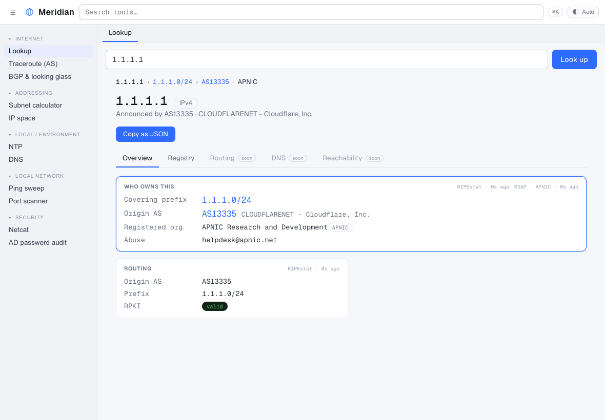
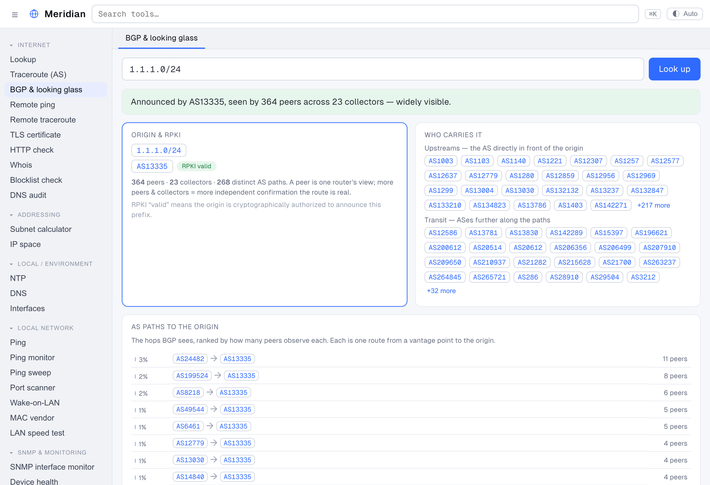

<div align="center">

# Meridian

**A cross-platform desktop toolkit for understanding networks, addresses, and routes.**

One native app for Windows, macOS, and Linux — no bundled browser, no account, no telemetry.

</div>

---

Meridian answers the everyday questions a network engineer actually asks — *who
owns this IP? what routes this prefix? is my clock source sane? what does DNS
really say?* — and explains every answer in plain language, not just raw numbers.

## Features

**Internet**
- **Lookup** — paste anything (`1.1.1.1`, `AS13335`, `104.16.0.0/13`,
  `cloudflare.com`) and get an entity page for the IP, ASN, prefix, or domain,
  with every related entity a click away. Routing (RIPEstat) + registration
  (RDAP) + AS ownership (Team Cymru), with RPKI status and related prefixes.
- **Traceroute (AS)** — unprivileged ICMP traceroute that annotates each hop
  with its autonomous system, so you see the *networks* a packet crosses.
- **BGP & looking glass** — the control-plane view of a prefix/IP: origin AS(es)
  (with MOAS warnings), the AS paths seen across public route collectors, your
  upstreams and transit, RPKI validity, and a searchable list of vantage points.

**Addressing**
- **Subnet calculator** — network/broadcast/host math and prefix splitting.
- **IP space** — record your own networks in a local, **passphrase-encrypted**,
  append-only inventory (argon2id + NaCl secretbox). Nothing leaves your machine.

**Local / environment**
- **NTP** — query a time server and read its stratum, offset, and health with a
  plain-language verdict.
- **DNS** — resolve any record type against any resolver, with DNSSEC signals.

## Screenshots

_Added per release — see `docs/media/`._

<!--  -->
<!--  -->

## Install

Builds are attached to each [GitHub Release](../../releases). Meridian is **not
yet code-signed**, so your OS will warn on first launch — this is expected for an
open-source app without a paid signing certificate.

- **macOS** — download the `.dmg`, drag Meridian to Applications, then launch it
  the first time:
  - **macOS 14 and earlier:** right-click the app → **Open** → **Open**.
  - **macOS 15 (Sequoia) and later:** a double-click will be blocked; open
    **System Settings → Privacy & Security**, scroll to the "meridian was blocked"
    notice, and click **Open Anyway**.

  Universal build (Apple Silicon + Intel).
- **Windows** — download the `.exe` and run it. SmartScreen may show
  "Windows protected your PC" → **More info → Run anyway**.
- **Linux** — download the `.AppImage`, then:
  ```bash
  chmod +x Meridian-*-linux-x86_64.AppImage
  ./Meridian-*-linux-x86_64.AppImage
  ```

## Build from source

### Prerequisites
- **Go 1.23+** — https://go.dev/dl/
- **Node 20+** and npm (the frontend is Svelte + TypeScript) — https://nodejs.org
- **Wails v2 CLI** — `go install github.com/wailsapp/wails/v2/cmd/wails@v2.10.1`
  (ensure `$(go env GOPATH)/bin` is on your `PATH`)
- **Platform toolchain:**
  - **Linux:** `sudo apt install libgtk-3-dev libwebkit2gtk-4.1-dev` (Debian/Ubuntu;
    use your distro's equivalents elsewhere), plus a C compiler (`build-essential`).
  - **macOS:** the Xcode command-line tools (`xcode-select --install`).
  - **Windows:** WebView2 (preinstalled on Windows 10/11) and a C compiler (e.g. via
    [MSYS2](https://www.msys2.org) or TDM-GCC).
- Run `wails doctor` to confirm your environment is ready.

### Clone and build
```bash
git clone https://github.com/hriday/meridian.git
cd meridian

wails dev     # hot-reload development build
wails build   # release build
```

On Linux, build with the WebKit 4.1 tag: `wails build -tags webkit2_41`.

The desktop binary lands in `build/bin/` (`meridian.app` on macOS,
`meridian.exe` on Windows, `meridian` on Linux). To match the official
multi-platform artifacts, see [`docs/RELEASING.md`](docs/RELEASING.md).

### Tests and the CLI
```bash
go test ./...                               # engine + CLI unit tests
go run ./cmd/meridian-cli lookup 1.1.1.1    # command-line counterpart
go run ./cmd/meridian-cli bgp 1.1.1.1       # e.g. the BGP looking glass
```

## Privacy

Meridian makes outbound requests **only when you ask it to**, to public
services: RDAP, RIPEstat, Team Cymru (IP-to-ASN), and the NTP/DNS servers you
query. Requests carry a generic `meridian/0.1 (+https://github.com/hriday/meridian)`
User-Agent and **no identifying information** — no account, no user identity, no
telemetry. Your IP-space inventory is stored locally and encrypted; it is never
uploaded.

## License

[Apache-2.0](LICENSE) © 2026 Hriday Balachandran
